**তারিখ:** ১৫ নভেম্বর ২০২৬
**কার জন্য:** যে ব্রাঞ্চে কাঁচামাল কিনে পণ্য তৈরি হয়, বড় প্যাকেট ভেঙে ছোট প্যাকেট হয়, আর বিক্রিতে ফ্রি মাল দেওয়া হয়।

এই নির্দেশিকার প্রতিটি ছবি একটি আসল পরীক্ষা থেকে নেওয়া। উদাহরণের সংখ্যাগুলোও সেই পরীক্ষার — চিনি আর আটা থেকে বিস্কুট বানানো।

---

## ১. পুরো কাজটা এক নজরে

**কাঁচামাল কেনা → মজুরি/খরচ লেখা → রেসিপি (একবার) → উৎপাদন (Draft → Post) → স্কিম (একবার) → বিক্রি → দরকার হলে ফেরত → রিপোর্ট**

| ধাপ | কোন মেনু | কী হয় |
| --- | --- | --- |
| ১ | Production → Production Purchase (বা সাধারণ Purchase) | কাঁচামাল স্টকে ঢোকে, কেনা দামে |
| ২ | Transaction → Cash Payment / Journal | কারখানার মজুরি, প্যাকিং মজুরি, পরিবহন খরচ লেখা হয় |
| ৩ | Production → Recipe | এক ব্যাচে কোন কাঁচামাল কতটুকু লাগে — একবার লিখে রাখা |
| ৪ | Production → Production Entry | কাঁচামাল বের হয়ে তৈরি পণ্য ঢোকে; খরচ হিসাব হয় |
| ৫ | Production → Scheme | "এতগুলো কিনলে এতগুলো ফ্রি" — একবার লিখে রাখা |
| ৬ | Production → Production Sales | তৈরি পণ্য বিক্রি, ফ্রি মাল নিজে যোগ হয় |
| ৭ | Production → Production Sales Return | বিক্রির মাল ফেরত |
| ৮ | Production → Register / Free Goods / Near Expiry | খরচ, লাভ, ফ্রি মাল, মেয়াদ দেখা |

**মূল কথা:** উৎপাদনে কোনো আলাদা খাতা লেখা হয় না। কাঁচামাল ও মজুরির খরচ তৈরি পণ্যের দামে বসে যায়, আর পণ্য বিক্রি হলে সেই খরচ বিক্রিত মালের খরচে (COGS) আসে।

---

## ২. শুরুর আগে — একবারের প্রস্তুতি

### ২.১ ব্রাঞ্চে Manufacturing চালু করা

1. **Branch List → Edit** → "Feature Controls" ধাপে **Control Manufacture?** চালু করে Save।
2. **Logout করে আবার Login** করুন — ব্রাঞ্চের সেটিং লগইনের সময় আসে।
3. উপরে **Production** মেনু দেখা যাবে। না দেখা গেলে নিচের অনুমতিগুলো দেখুন।

### ২.২ অনুমতি (Roles)

| অনুমতি | কী খোলে |
| --- | --- |
| production.view | Production মেনু দেখা |
| production.create | Production Entry, Recipe, Scheme, Production Sales, Production Purchase |
| production.post | ব্যাচ Post করা |
| production.reverse | ব্যাচ Reverse করা |
| production.report.view | Register, Free Goods, Near Expiry |
| production.sales.return.create | Production Sales Return |

### ২.৩ দশমিক ঘর ২ রাখুন (জরুরি)

ব্রাঞ্চের সেটিং-এ (Branch List → Edit) **Decimal places = 2** রাখুন। ০ থাকলে সব টাকা পূর্ণ সংখ্যায় দেখায় — যেমন আসল খরচ ৭৮.৯৫ হলে Register-এ দেখায় "79", আর Batch Costing-এ ৭৮.৭০ ও ৭৮.৯৫ দুটো সারিই "79" দেখায়। হিসাব ঠিক থাকে, কিন্তু পড়তে ভুল হয়।

### ২.৪ পণ্য তৈরি (Products → Add Product)

- **কাঁচামাল** — Product Type: **Raw Materials**, Unit: যে এককে স্টক রাখবেন (যেমন Kg)।
- **তৈরি পণ্য** — Product Type: **Inventory**, আলাদা নাম ও কোড। ছোট প্যাকেট আলাদা পণ্য, আলাদা কোড।
- **খালি প্যাকেট, লেবেল, কার্টন** — এগুলোও কাঁচামাল হিসেবে কিনুন, রেসিপিতে Packaging হিসেবে দিন।
- **বস্তায় কেনা মাল** — পণ্যে **Package unit = Bag** আর **Package size = 50** দিলে (১ Bag = ৫০ Kg), উৎপাদনে বস্তার সংখ্যায় লেখা যায়; স্টক থেকে কেজিই বের হয়।

### ২.৫ খরচের খাত

Chart of Accounts-এ এই তিনটি খাত নিজে থেকেই থাকে: **Factory Labour, Packing Labour, Factory Transport**। উৎপাদনের খরচ শুধু এই খাত থেকেই নেওয়া যায়। অফিস খরচ, বিদ্যুৎ, ভাড়া পণ্যের দামে যোগ হয় না — সেগুলো সাধারণ খরচ হিসেবেই থাকে।

---

## ৩. ধাপ ১ — কাঁচামাল কেনা

**মেনু:** Production → Production Purchase

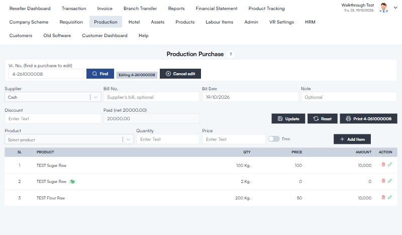

1. **Supplier** দিন। সরবরাহকারীর বিল থাকলে **Bill No.** আর **Bill Date** লিখুন — পরে কোন বিল ও বিলের তারিখের বিপরীতে কেনা হয়েছিল তা দেখা যায়, আর কাগজে Bill No. ছাপা হয়। চাইলে Note।
2. ভাউচারের তারিখ দিতে হয় না — সিস্টেমের লেনদেনের তারিখ (Trx. Dt.) নিজে থেকেই বসে; সংশোধনেও ভাউচারের তারিখ বদলায় না।
3. **Product** বাছলে তার Purchase Price নিজে বসে (দরকারে বদলান); **Quantity** দিয়ে **Add Item**।
4. সরবরাহকারী **ফ্রি মাল** দিলে: একই পণ্য বেছে **Free** সুইচ চালু করুন, Quantity দিন — দাম নিজে থেকেই ০ হয়, সারির পাশে **ফ্রি** লেখা আসে।
5. **Discount** ও **Paid** দিন (পণ্য লাইনের উপরের সারিতে)। Cash সরবরাহকারীতে Paid নিজে পুরো টাকা বসায়; অন্যদের ০ থেকে শুরু, বাকি থাকে।
6. পাশের **Save**, তারপর দরকারে **Print** — সাধারণ Purchase Invoice-এর কাগজে, ফ্রি সারির পাশে (ফ্রি) লিখে ছাপা হয়।

**উদাহরণে:** চিনি ১০০ kg × ৳১০০ + চিনি ২ kg ফ্রি + আটা ২০০ kg × ৳৫০ = মোট ৳২০,০০০। স্টকে চিনি ১০২ kg ঢোকে — ১০০ kg ৳১০০ দামে, ২ kg ৳০ দামে। মোট স্টক মূল্য ঠিক ৳২০,০০০ থাকে।

> **জানা দরকার:** ভাউচার নম্বর সাধারণ ক্রয়ের মতোই — টাকা দিলে **4-**, বাকি হলে **9-**। Cash Book, Purchase Ledger-এ এটা সাধারণ ক্রয়ের সাথেই দেখায়। সংশোধন করতে উপরের **Vr. No.**-এ নম্বর দিয়ে **Find** → বদলে **Update**। সাধারণ Purchase স্ক্রিন থেকে এটা সংশোধন করা যায় না।
>
> ফ্রি মাল না থাকলে সাধারণ **Invoice → Purchase** দিয়েও কেনা যায়।

---

## ৪. ধাপ ২ — মজুরি ও কারখানার খরচ

**মেনু:** Transaction → Cash Payment (নগদ দিলে) বা Journal (বাকি থাকলে)

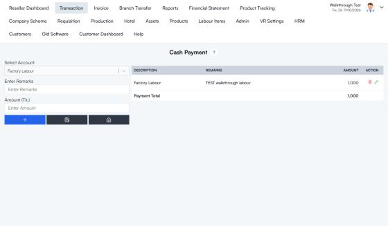

1. **Select Account**-এ **Factory Labour** (বা Packing Labour / Factory Transport)।
2. Remarks ও Amount দিয়ে **+**, তারপর **Save**।

**মজুরি পরে দেবেন?** উৎপাদনের দিন **Journal** দিন: Factory Labour ডেবিট / শ্রমিক-পাওনা ক্রেডিট। পরে টাকা দেওয়ার দিন Cash Payment দিয়ে পাওনা শোধ।

> ⚠️ খরচ আর উৎপাদন **একই মাসে** হতে হবে। অন্য মাসের খরচ উৎপাদনে নেওয়া যায় না।

---

## ৫. ধাপ ৩ — রেসিপি (একবার)

**মেনু:** Production → Recipe

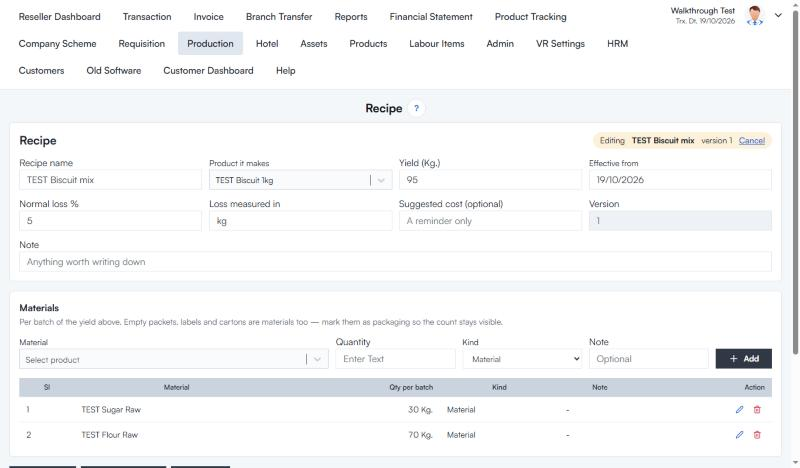

1. **Recipe name**, **Product it makes** (তৈরি পণ্য)।
2. **Yield** — এক ব্যাচে কতটা ভালো পণ্য হয় (উদাহরণে ৯৫ kg)। ঘরে ধূসর "e.g. 95" শুধু উদাহরণ — নিজে লিখতে হবে।
3. **Normal loss %** — স্বাভাবিক নষ্টের সীমা (উদাহরণে ৫%)।
4. **Effective from** — এই তারিখ থেকে রেসিপি চালু। এর আগের তারিখের উৎপাদনে রেসিপিটি দেখাবে না।
5. **Materials**-এ Material, Quantity, Kind (Material / Packaging) দিয়ে **Add** — উদাহরণে চিনি ৩০ kg, আটা ৭০ kg।
6. **Save**।

**পরে বদলাতে হলে:** তালিকার পেন্সিলে খুলে ঠিক করে Save (ছোট সংশোধন), অথবা উপকরণ/পরিমাণ বড় করে বদলালে **New version** — পুরনো সংস্করণ থাকে, আগের ব্যাচের হিসাব বদলায় না।

রেসিপি ছাড়াও উৎপাদন করা যায় — তখন Production Entry-তে "Enter by hand" রেখে নিজে লাইন দিন।

---

## ৬. ধাপ ৪ — উৎপাদন (Production Entry)

**মেনু:** Production → Production Entry

উৎপাদন দুই ধাপে: আগে **Draft** (কিছু নড়ে না), তারপর **Post** (স্টক নড়ে)।

### ৬.১ ব্যাচের মাথা

- **Production date** — নিজে থেকে ব্রাঞ্চের লেনদেনের তারিখ।
- **Batch ref** — খালি রাখলে ভাউচার নম্বরই ব্যাচের নাম হয়।
- **Recipe** বাছলে উপকরণ, Make (কত বানাবেন) আর তৈরি পণ্য নিজে ভরে যায়। Make বদলালে **Fill** চাপুন।

### ৬.২ প্রথম ধাপ — Materials in (কাঁচামাল)

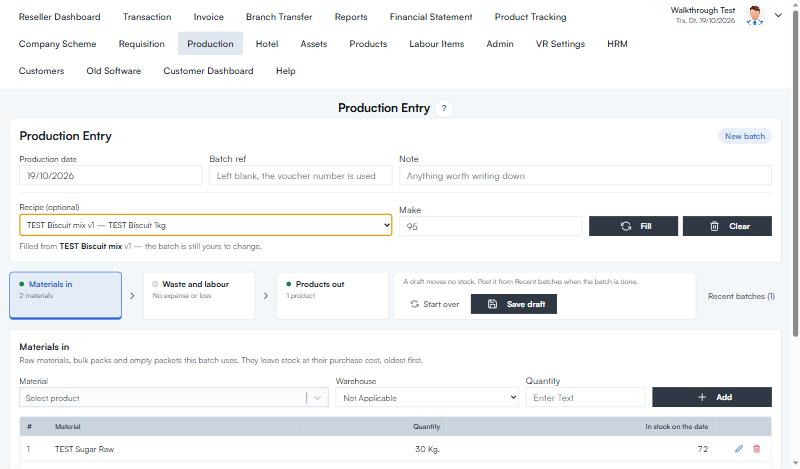

- প্রতিটি লাইনের পাশে ওই তারিখে কত স্টক আছে দেখায়। রেসিপির চেয়ে কম থাকলে নিচে লাল টেবিলে ঘাটতি দেখায়।
- বস্তায় লিখতে চাইলে লাইনের পেন্সিল চাপুন → **Unit**-এ **Bag** বাছুন → বস্তার সংখ্যা লিখুন। নিচে কত Kg হলো দেখায় (১.৪ Bag = ৭০ Kg) → **Update**।

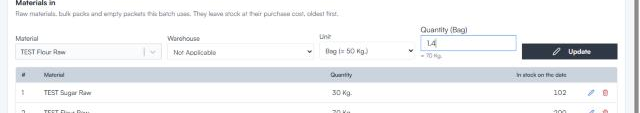

### ৬.৩ দ্বিতীয় ধাপ — Waste and labour (নষ্ট ও মজুরি)

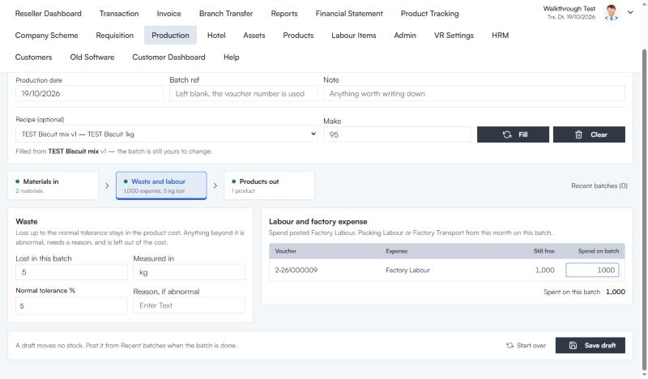

- **Lost in this batch** — কতটা নষ্ট হলো (উদাহরণে ৫ kg)।
- **Normal tolerance %** — স্বাভাবিক সীমা। সীমার বেশি নষ্ট হলে **Reason** লিখতে হয়; বাড়তি অংশ "অস্বাভাবিক নষ্ট" হিসেবে আলাদা থাকে, পণ্যের দামে ঢোকে না।
- ডানে এই মাসের মজুরি/খরচের ভাউচারগুলো আসে। **Spend on batch**-এ এই ব্যাচে কতটা যাবে লিখুন (উদাহরণে ৳১,০০০)। একই ভাউচারের টাকা কয়েক ব্যাচে ভাগ করা যায়, মোটের বেশি নয়।

### ৬.৪ তৃতীয় ধাপ — Products out (তৈরি পণ্য)

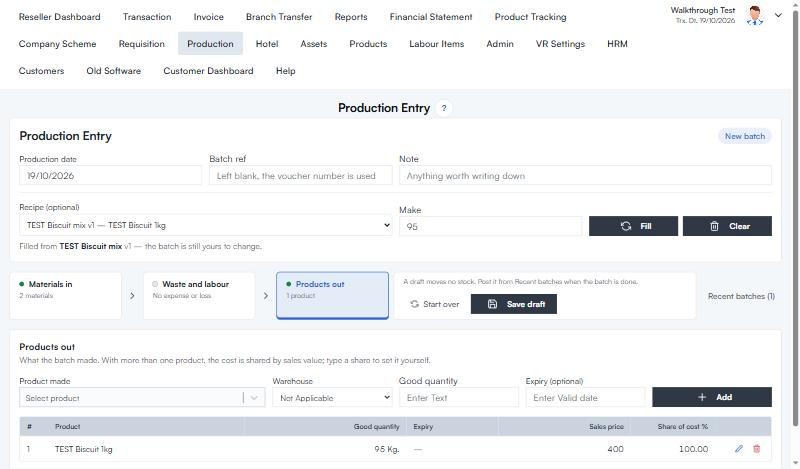

- **Product made, Good quantity**, আর ঐচ্ছিক **Expiry** (মেয়াদ)।
- একাধিক পণ্য হলে খরচ বিক্রয়মূল্যের অনুপাতে ভাগ হয়; চাইলে **Share of cost %** নিজে লিখুন।
- তিন ধাপের ডান পাশের বারে **Save draft** চাপুন — যেকোনো ধাপ থেকেই সেভ করা যায়; **Start over** দিলে ফর্ম খালি হয়।

### ৬.৫ Post ও Reverse

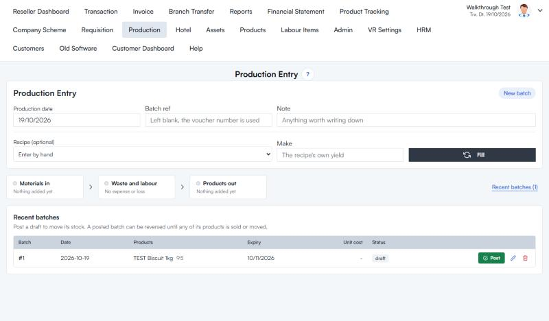

- **Recent batches** খুলে **Post** চাপুন। কাঁচামাল স্টক থেকে বের হয় (আগে কেনা আগে, FIFO), তৈরি পণ্য ঢোকে।

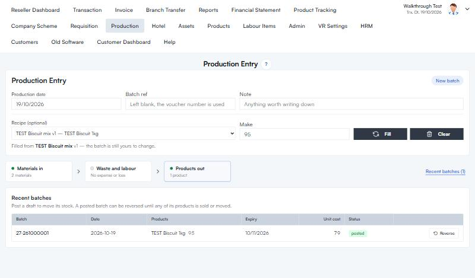

- **Reverse** — পোস্ট করা ব্যাচ উল্টানো যায়, যতক্ষণ তার পণ্য বিক্রি, ট্রান্সফার বা অন্য কাজে লাগেনি। Reverse করলে কিছু মোছে না; কাঁচামাল ফেরত আসে, খরচ মুক্ত হয়।
- Draft থাকলে পেন্সিলে বদলানো আর লাল চিহ্নে মোছা যায়।

**উদাহরণের হিসাব:**

| | টাকা |
| --- | --- |
| চিনি ৩০ kg × ৳১০০ | ৩,০০০ |
| আটা ৭০ kg × ৳৫০ | ৩,৫০০ |
| মজুরি | ১,০০০ |
| **মোট খরচ** | **৭,৫০০** |
| ভালো পণ্য | ৯৫ kg |
| **প্রতি kg খরচ** | **৭৮.৯৫** |

পয়সার হিসাব মেলাতে একটি ইউনিট আলাদা দামে আগে বসে: ১ kg × ৭৮.৭০ + ৯৪ kg × ৭৮.৯৫ = ৭,৫০০.০০।

---

## ৭. ধাপ ৫ — ফ্রি মালের নিয়ম (Scheme, একবার)

**মেনু:** Production → Scheme

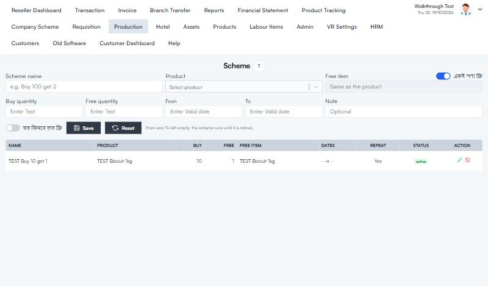

1. **Scheme name** (যেমন Buy 10 get 1), **Product**, **Buy quantity**, **Free quantity**।
2. যে পণ্য কেনা হলো ফ্রিতেও সেটাই গেলে Free item-এর পাশের **একই পণ্য ফ্রি** সুইচ চালু রাখুন; অন্য পণ্য হলে সুইচ বন্ধ করে সেই পণ্য বাছুন।
3. **যত কিনবে তত ফ্রি** সুইচ চালু থাকলে প্রতি ধাপে ফ্রি মেলে — ১০-এ ১ স্কিমে ৩০টা কিনলে ৩টা ফ্রি; বন্ধ থাকলে ইনভয়েসে একবারই, ৩০টা কিনলেও ১টা।
4. **From / To** — স্কিম কোন তারিখ থেকে কোন তারিখ পর্যন্ত চলবে (নিচে বিস্তারিত)।
5. **Save**। বন্ধ করতে সারির লাল চিহ্নে Retire — পুরনো বিক্রি অক্ষত থাকে।

### ৭.১ "যত কিনবে তত ফ্রি" — ফ্রি একবার, নাকি বারবার

এই সুইচ ঠিক করে, একটি ইনভয়েসে ফ্রি একবারই মিলবে, নাকি প্রতি ধাপে বারবার মিলবে। সুইচের পাশে হিসাবটাও লেখা থাকে, যেমন "যত কিনবে তত ফ্রি · প্রতি ১০-এ ১"।

উদাহরণ — স্কিম **১০টা কিনলে ১টা ফ্রি**, কাস্টমার এক ইনভয়েসে **৩০টা** কিনলেন:

| সুইচ | কত ফ্রি | কেন |
| --- | --- | --- |
| **চালু** | **৩টা** | প্রতি ১০টায় ১টা — ১০, ২০, ৩০, তিনবার |
| **বন্ধ** | **১টা** | ১০ পার হলেই ১টা; যত বেশিই কিনুক, আর বাড়ে না |

সুইচ চালু থাকলে আরও কিছু হিসাব:

| কত কিনলেন | কত ফ্রি |
| --- | --- |
| ৯টা | ০ (১০ হয়নি) |
| ১৫টা | ১টা |
| ২৫টা | ২টা |
| ৩০টা | ৩টা |

### ৭.২ From ও To — স্কিম কতদিন চলবে

From আর To হলো স্কিমের শুরু আর শেষের তারিখ। বিক্রির তারিখ বলতে সিস্টেমের লেনদেনের তারিখ (Trx. Dt.) ধরা হয়।

| From | To | স্কিম কখন চলবে |
| --- | --- | --- |
| ০১/১১/২০২৬ | ৩০/১১/২০২৬ | শুধু নভেম্বর মাসে; ৩০ তারিখের পর নিজে থেকেই বন্ধ |
| ০১/১১/২০২৬ | খালি | ১ নভেম্বর থেকে শুরু, শেষ নেই |
| খালি | ৩০/১১/২০২৬ | এখনই চালু, ৩০ নভেম্বর পর্যন্ত |
| **খালি** | **খালি** | **কোনো সময়সীমা নেই — নিজে বন্ধ না করা পর্যন্ত চলবে** |

স্ক্রিনে লেখা "From and To left empty: the scheme runs until it is retired" — এর মানে এটাই: দুটো তারিখ খালি রাখলে স্কিমটি বন্ধ না করা পর্যন্ত চলতে থাকবে।

**বন্ধ করা (Retire):** নিচের তালিকায় স্কিমের সারির লাল (⊘) চিহ্নে চাপুন। বন্ধ করলে আগের বিক্রির হিসাব যেমন ছিল তেমনই থাকে; শুধু নতুন বিক্রিতে আর ফ্রি যোগ হয় না।

---

## ৮. ধাপ ৬ — বিক্রি (Production Sales)

**মেনু:** Production → Production Sales

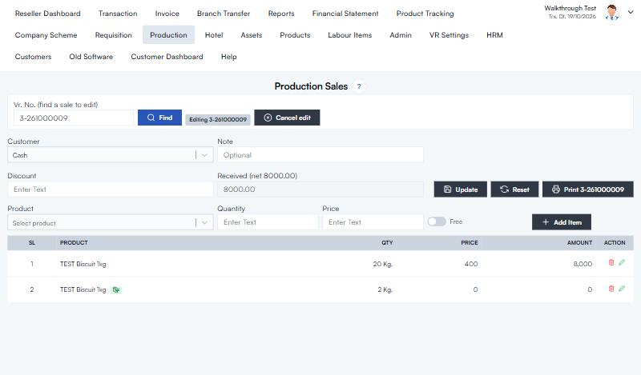

1. **Customer** দিন। তারিখ দিতে হয় না — সিস্টেমের লেনদেনের তারিখ (Trx. Dt.) নিজে থেকেই বসে; সংশোধনেও বিক্রির তারিখ বদলায় না। Cash কাস্টমারে Received নিজে পুরো টাকা বসায়।
2. **Product** বাছলে তার Sales Price নিজে বসে (দরকারে বদলান); **Quantity** দিয়ে **Add Item**।
3. স্কিম মিললে ফ্রি সারি **নিজে থেকে যোগ হয়** — উদাহরণে ২০ kg বিক্রিতে "2 free added", দাম ০, পাশে **ফ্রি**।
4. স্কিম ছাড়া ফ্রি দিতে চাইলে **Free** সুইচ চালু করে আলাদা সারি দিন।
5. **Discount** ও **Received** (পণ্য লাইনের উপরের সারিতে), Note দিয়ে পাশের **Save**।
6. **Print** — সাধারণ Sales Invoice-এর কাগজে ছাপা হয়, ফ্রি সারির পাশে (ফ্রি) লেখা থাকে। Find করে খোলা বিক্রি থাকলে সেটি, নইলে শেষ সেভ করা বিক্রি ছাপা হয়।

> - নম্বর সাধারণ বিক্রির মতোই — টাকা পেলে **3-**, বাকি হলে **10-**। Cash Book, Sales Ledger-এ সাধারণ বিক্রির সাথেই দেখায়।
> - ফ্রি সারির টাকা ০, তাই বিক্রির অঙ্কে কিছু যোগ হয় না; কিন্তু মাল স্টক থেকে বের হয়, তার খরচ বিক্রিত মালের খরচে ধরা থাকে।
> - শুধু ফ্রি সারি দিয়ে বিক্রি সেভ হয় না — অন্তত একটি দামওয়ালা সারি লাগে।
> - ফ্রি মাল ছাড়া বিক্রি সাধারণ **Invoice → Sales** দিয়েও করা যায়।

---

## ৯. ধাপ ৭ — বিক্রির মাল ফেরত (Production Sales Return)

**মেনু:** Production → Production Sales Return

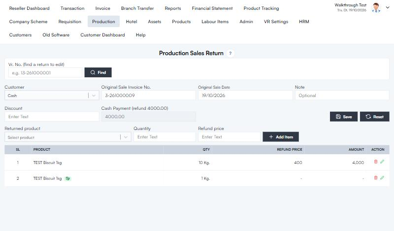

1. **Customer** ও **Original Sale Invoice No.** (বাধ্যতামূলক — খরচ ওই বিক্রি থেকেই পড়া হয়)।
2. **Original Sale Date** নিজে থেকে ব্রাঞ্চের লেনদেনের তারিখ নেয়; **ফেরতের ভাউচার এই তারিখেই হয়**।
3. **Returned product, Quantity, Refund price** → **Add Item**।
4. **Discount** ও **Cash Payment** (পণ্য লাইনের উপরের সারিতে), তারপর পাশের **Save**। Cash কাস্টমারে পুরো টাকা নগদ ফেরত; অন্যদের শুধু পাওনা কমে।

### ফ্রি মালও ফেরত আনুন — নিজে যোগ করতে হয়

ফ্রি মালের সারি ফেরতের তালিকায় **নিজে থেকে আসে না**। একই পণ্য বেছে **Refund price = 0** দিয়ে আলাদা সারি যোগ করুন — সারির পাশে **ফ্রি** লেখা আসে। উপরের ছবিতে দ্বিতীয় সারিটি এমন ফ্রি সারি (১০ kg দামওয়ালার সাথে ১ kg ফ্রি)।

কত ফ্রি ফেরত নেওয়া যাবে তা সিস্টেম হিসাব করে: দামওয়ালা কতটা ফেরত এল তার অনুপাতে। উদাহরণে ২০ kg বিক্রিতে ২ kg ফ্রি ছিল; ১০ kg ফেরতে ১ kg ফ্রি ফেরত আনা যায়। বেশি চাইলে, বা আগের ফেরতে প্রাপ্য ফ্রি আগেই নেওয়া হয়ে গেলে, সেভ হয় না — কতটা নেওয়া যাবে তা বার্তায় লেখা থাকে:

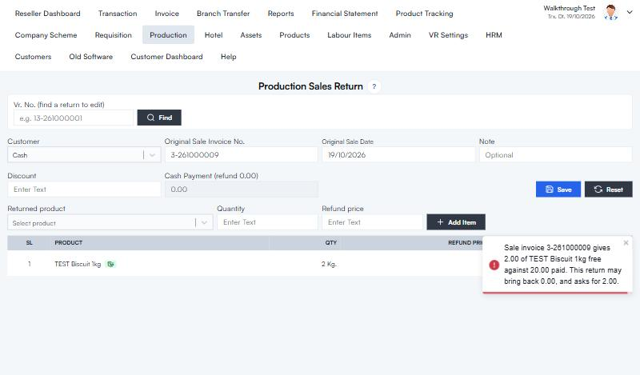

> - টাকা ফেরত হয় শুধু দামওয়ালা সারির। ফেরত মাল স্টকে ঢোকে মূল বিক্রির খরচে (উদাহরণে ৭৮.৯৪), বিক্রির দামে নয় — তাই ফেরতের জন্য লাভ বেশি দেখায় না।
> - মূল বিক্রির চেয়ে বেশি ফেরত নেওয়া যায় না (আগের ফেরত মিলিয়ে)।
> - নম্বর সাধারণ ফেরতের মতোই **13-**। সংশোধন: উপরে Vr. No. দিয়ে Find।

---

## ১০. রিপোর্ট

### ১০.১ Production Register

**মেনু:** Production → Production Register — From/To দিয়ে Search।

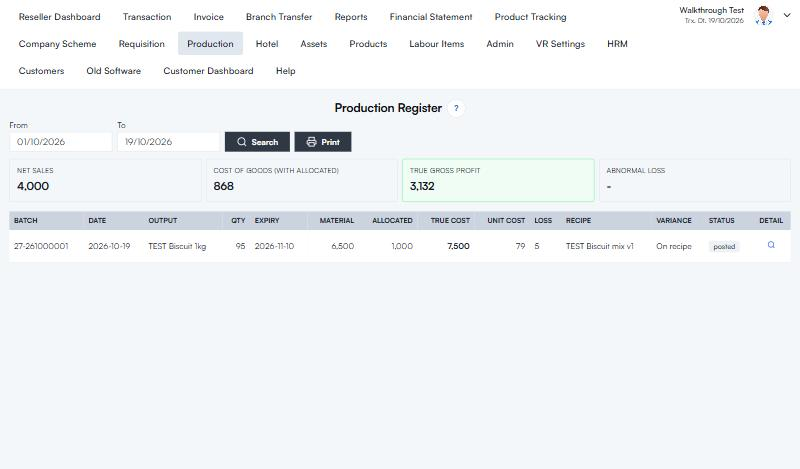

- উপরে **Net sales, Cost of goods (with allocated), True gross profit, Abnormal loss**।
- প্রতি ব্যাচে কাঁচামাল, মজুরি, মোট খরচ, প্রতি ইউনিট খরচ, নষ্ট, রেসিপি।
- **Variance** — রেসিপির সাথে তুলনা: "On recipe", বা লাল লেখায় বেশি উপকরণ / কম উৎপাদন / বেশি নষ্ট।
- সারি লাল আর **source changed** — যে খরচ বা কেনার ভাউচার থেকে দাম এসেছিল সেটা পরে বদলেছে। ঠিক করতে ব্যাচ Reverse করে আবার Post।

**উদাহরণে:** বিক্রি ৮,০০০ − ফেরত ৪,০০০ = Net sales **৪,০০০**; খরচ **৮৬৮**; আসল মোট লাভ **৩,১৩২**।

### ১০.২ Batch Costing (ব্যাচের পুরো খরচ)

Register-এর Detail চিহ্নে খোলে।

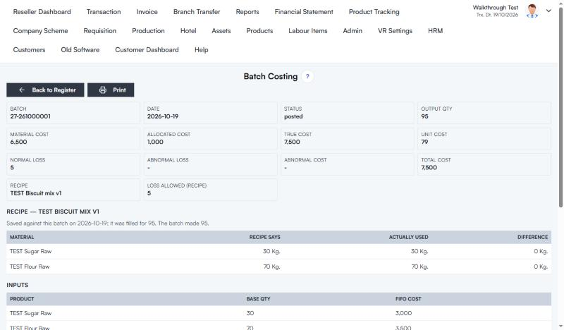

রেসিপি বনাম আসল, কোন কেনা থেকে কত কাঁচামাল কোন দামে গেছে, কোন খরচের ভাউচার থেকে কত টাকা, আর তৈরি পণ্যের দামের সারি। **Print**-এ প্যাডসহ ছাপা হয়।

### ১০.৩ Free Goods

**মেনু:** Production → Free Goods

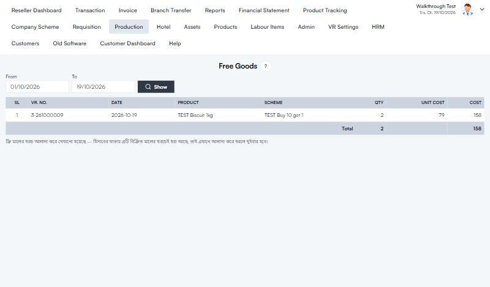

কোন বিক্রিতে, কোন স্কিমে কত ফ্রি দেওয়া হয়েছে আর তার খরচ। এই খরচ আগেই বিক্রিত মালের খরচে ধরা আছে — আবার খরচ হিসেবে যোগ করবেন না। (রিপোর্টটি দেওয়া ফ্রি দেখায়; ফেরত আসা ফ্রি এখানে বাদ যায় না।)

### ১০.৪ Near Expiry

**মেনু:** Production → Near Expiry — As of ও Within (days) দিয়ে Show।

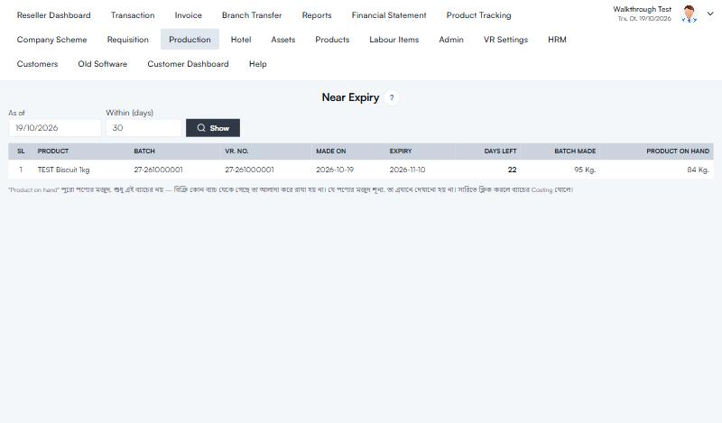

মেয়াদ শেষের কাছাকাছি ব্যাচ। **Product on hand** পণ্যটির মোট মজুদ, শুধু ওই ব্যাচের নয়। মেয়াদ পার হলে লাল "Expired"।

### ১০.৫ সাধারণ রিপোর্টে কী দেখায়

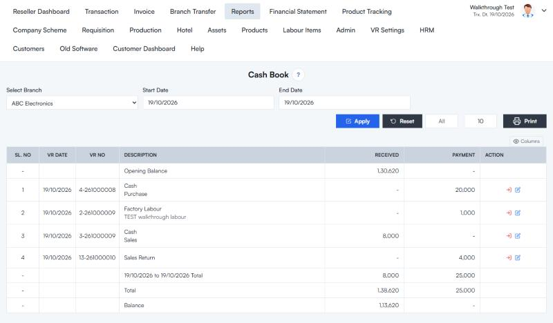

- **Cash Book / Bank Book, Sales/Purchase Ledger** — Production Sales/Purchase/Return সাধারণ ভাউচারের সাথেই আসে। উদাহরণে: ক্রয় ২০,০০০, মজুরি ১,০০০, বিক্রি ৮,০০০, ফেরত ৪,০০০।
- **Profit & Loss** — ব্যাচে নেওয়া মজুরি "Cost of Goods Sold"-এর **Direct Acquisition Costs** লাইনে আসে, আর খরচের তালিকা থেকে সেই অঙ্ক বাদ যায় — তাই Gross profit আসলটা দেখায়, Net profit বদলায় না।
- **Product Ledger / Stock** — উৎপাদনে বের হওয়া কাঁচামাল ও ঢোকা পণ্য দেখায়।

---

## ১১. সতর্কতা ও সাধারণ ভুল

| পরিস্থিতি | কী করবেন |
| --- | --- |
| মজুরির ভাউচার Spend on batch-এ আসছে না | ভাউচারটা Factory Labour / Packing Labour / Factory Transport খাতে কি না, আর উৎপাদনের একই মাসে কি না দেখুন |
| রেসিপি তালিকায় আসছে না | রেসিপির Effective from উৎপাদনের তারিখের পরে কি না দেখুন |
| Make বদলানোর পর সেভ হচ্ছে না | Fill চাপুন |
| ব্যাচ Reverse হচ্ছে না | তার পণ্য বিক্রি বা ট্রান্সফার হয়ে গেছে; আগে সেগুলো ঠিক করুন |
| খরচের ভাউচার Edit হচ্ছে না | যে ব্যাচ খরচ নিয়েছে সেটা আগে Reverse করুন |
| ফেরতে ফ্রি মাল স্টকে ফিরছে না | ফ্রি সারি নিজে যোগ করুন, Refund price ০ দিয়ে |
| টাকা পূর্ণ সংখ্যায় দেখাচ্ছে | ব্রাঞ্চের Decimal places ২ করুন |
| Production Sales/Purchase সাধারণ Sales/Purchase স্ক্রিনে Update হচ্ছে না | এটাই নিয়ম — Production স্ক্রিনে Vr. No. দিয়ে Find করে সংশোধন করুন |
| বিদ্যুৎ, ভাড়া পণ্যের দামে যোগ করতে চান | এখন হয় না; এগুলো সাধারণ খরচ হিসেবেই থাকে |

---

## ১২. দৈনিক কাজের চেকলিস্ট

1. কাঁচামাল এলে → Production Purchase (বিল নম্বর ও বিলের তারিখ দিন; ফ্রি থাকলে Free সুইচ)।
2. মজুরি দিলে → Cash Payment, Factory Labour খাতে।
3. উৎপাদন শেষে → Production Entry: রেসিপি বাছুন → নষ্ট ও মজুরি → মেয়াদ → Save draft → Post।
4. বিক্রি → Production Sales (স্কিমের ফ্রি নিজে আসে)।
5. ফেরত → Production Sales Return (ফ্রি সারি নিজে যোগ করুন)।
6. সপ্তাহে একবার → Production Register (লাল সারি আছে কি না) আর Near Expiry।
