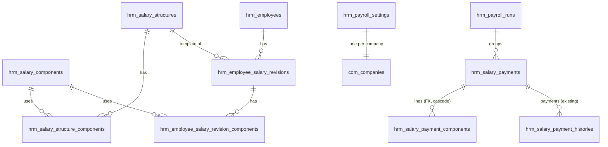

# Flexible Salary Components — পুরো সিস্টেম কীভাবে কাজ করে

**Date:** 2026-11-23
**অবস্থা:** Phase 1 (ভিত্তি) backend-এ লেখা ও local database `nibirnirman`-এ যাচাই করা। নতুন screen ও নতুন Salary Generate এখনো তৈরি হয়নি।
**Design:** [`salary-management-flexible-components.md`](./salary-management-flexible-components.md) · **Reference DDL:** [`salary-components-schema.sql`](./salary-components-schema.sql)

এই ডকুমেন্টে আলাদা করে দেখানো আছে কোনটা **এখন চালু (✅)** আর কোনটা **পরিকল্পিত (🕓)**।

---

## 1. এক কথায়

আগে প্রতিটি বেতন খাত (Basic, Mobile Bill...) ছিল `hrm_employees`-এর একটি fixed column। নতুন খাত মানেই নতুন column আর সব screen-এ কোড বদল।

এখন খাতগুলো **data**:

```text
কোন কোন খাত আছে        → hrm_salary_components         (কোম্পানি নিজে বানাবে)
কোন খাতের সেট          → hrm_salary_structures          (template)
কোন employee কত পায়    → hrm_employee_salary_revisions  (তারিখসহ, কখনো overwrite নয়)
কোন মাসে কত পেল        → hrm_salary_payments + hrm_salary_payment_components (freeze)
```

নতুন কোম্পানি "Lunch Bill" চাইলে কোড deploy লাগবে না, শুধু একটি row যোগ হবে।

---

## 2. কোড কোথায় আছে

| ফাইল (backend `cashbook_api`) | কাজ |
|---|---|
| `app/Services/Hrms/SalaryComponentSchema.php` | ✅ সব কাজ এখানে: table তৈরি, column যোগ, seed, backfill |
| `app/Console/Commands/AddUnitTypeToBuildingUnits.php` → `runSalaryComponentSchema()` | ✅ পুরোনো site-এ patch দিয়ে service চালায় ও ফল দেখায় |
| ঐ command-এর `syncPermissions()` ও `handle()` | ✅ তিনটি permission তৈরি ও role-কে দেওয়া |
| `database/migrations/2026_11_23_000001_create_hrm_salary_components_tables.php` | ✅ নতুন install-এ একই service চালায় |
| `SalaryCalculator` service, Preview/Generate API | 🕓 Phase 2 |
| Salary Components / Structures screen, Employee Salary tab | 🕓 Phase 1-এর UI অংশ |

**এক definition, দুই রাস্তা:** patch আর migration দুটোই `SalaryComponentSchema::run()` ডাকে। তাই পুরোনো site আর নতুন install-এ table-এর গঠন কখনো আলাদা হবে না।

---

## 3. Patch চালালে ধাপে ধাপে কী হয়

```powershell
php artisan patch:add-unit-type
```

```text
handle()
 ├─ syncPermissions()                      → ৩টি নতুন permission row (না থাকলে)
 ├─ grantToAdministrators() × ৩            → Super Administrator / Administrator / DBA-কে একবার
 ├─ seedPermissionFrom('hrm.salary.setup.edit', …) × ৩
 │                                          → যারা এখন Salary Setup edit করতে পারে, তাদেরকে একবার
 │   … (অন্যান্য patch) …
 └─ runSalaryComponentSchema()  (নিজের try-এ; fail করলে শুধু warning)
      └─ SalaryComponentSchema::run()
           0. hrm_employees ও hrm_salary_payments আছে? না থাকলে skip (HRMS নেই এমন site)
           1. createTables()                  → ৮টি table, শুধু যেগুলো নেই
           2. alterSalaryPayments()           → payroll_run_id, period_ym + index
           3. addPaymentComponentForeignKey() → line → salary row (ON DELETE CASCADE)
           4. seedCompanies()                 → প্রতিটি company: settings, ১২ pay head, Default Structure
           5. backfillRevisions()             → একটি transaction-এ employee revision
```

### 3.1 নিরাপত্তার নিয়ম (re-runnable)

| ধাপ | কীভাবে দ্বিতীয়বার চালালেও কিছু দুবার হয় না |
|---|---|
| Table | `Schema::hasTable()` দেখে, তারপর `CREATE TABLE IF NOT EXISTS` |
| Column / index / FK | `hasColumn()` / `information_schema` দেখে |
| Settings, pay head, structure | `insertOrIgnore` — unique key `(company_id, code)`; আগে থাকা row (screen-এ rename করা নামসহ) বদলায় না |
| Revision | শুধু যে employee-এর **কোনো** revision নেই |
| Revision line | `INSERT IGNORE` — unique `(revision_id, component_id)` |
| Permission grant | grant mark দিয়ে একবারই; কেউ হাতে সরালে আর ফিরে আসে না |

### 3.2 কী কী বদলায় না

- `hrm_employees`-এর কোনো column বা row।
- `hrm_salary_payments`-এর কোনো পুরোনো মান — শুধু দুটি নতুন column যোগ হয় (`payroll_run_id` NULL, `period_ym` নিজে হিসাব হয়)।
- পুরোনো Salary Generate / Sheet / Print — এগুলো আগের মতোই চলে। **Phase 1-এ কারো বেতন বদলায় না।**

---

## 4. Table-গুলো এবং সম্পর্ক



| Table | নতুন/পুরোনো | কী রাখে |
|---|---|---|
| `hrm_payroll_settings` | নতুন | কোম্পানির নিয়ম: attendance deduction-এর ভাজক (fixed 30 / মাসের দিন), rounding, পুরো মাসে rounding বাদ |
| `hrm_salary_components` | নতুন | বেতনের খাত — code, নাম, earning/deduction, হিসাবের ধরন, prorate, rounding, ledger |
| `hrm_salary_structures` | নতুন | Template, যেমন "Default Salary Structure" |
| `hrm_salary_structure_components` | নতুন | Template-এ কোন খাত, default amount, ক্রম |
| `hrm_employee_salary_revisions` | নতুন | Employee-এর বেতন, `effective_from`–`effective_to` সহ |
| `hrm_employee_salary_revision_components` | নতুন | ঐ revision-এ খাতভিত্তিক amount |
| `hrm_payroll_runs` | নতুন | একটি sheet-এর header: মাস, branch, status (draft → approved → paid), মোট |
| `hrm_salary_payments` | **পুরোনো** | Employee-প্রতি মাসিক বেতনের row, voucher `main_trx_id` সহ। + `payroll_run_id`, `period_ym` |
| `hrm_salary_payment_components` | নতুন | ঐ row-এর খাতভিত্তিক লাইন: frozen নাম, rate, quantity, amount, ledger |
| `hrm_salary_payment_histories` | পুরোনো | আংশিক payment — অপরিবর্তিত |

> আলাদা `hrm_payroll_items` table ইচ্ছা করেই নেই। একই মাসের বেতন দুই table-এ থাকলে কোনটা সঠিক তা নিয়ে গোলমাল হতো।

---

## 5. Seed — প্রতিটি company যা পায়

`hrm_employees`-এ যত `company_id` আছে, প্রত্যেকের জন্য:

**Settings:** `fixed` ভাজক 30, deduction rounding `nearest_10`, `full_month_skip_rounding = 1` — হুবহু বর্তমান হিসাব।

**১২টি pay head:**

| code | ধরন | হিসাব | prorate | rounding | deduction base | sheet | system |
|---|---|---|---|---|---|---|---|
| `basic` | earning | fixed | ✔ | up_10 | ✔ | monthly, overtime | ✔ |
| `house_rent` | earning | fixed | ✔ | up_10 | ✔ | monthly | |
| `medical_allowance` | earning | fixed | | none | | monthly | |
| `mobile_bill` | earning | fixed | ✔ | up_10 | ✔ | monthly | |
| `lunch_bill` | earning | per_day (present) | | nearest_1 | | monthly | |
| `attendance_bonus` | earning | per_day (present) | | nearest_1 | | monthly | |
| `mid_day_meal` | earning | per_day (present) | | nearest_1 | | monthly | |
| `conveyance` | earning | fixed | ✔ | none | | monthly | |
| `overtime` | earning | system | | none | | overtime | ✔ |
| `loan_deduction` | deduction | system | | nearest_1 | | monthly | ✔ |
| `attendance_deduction` | deduction | system | | nearest_10 | | monthly | ✔ |
| `other_deduction` | deduction | fixed | | nearest_1 | | monthly | |

সবগুলোর `is_taxable = 0`, `expense_ledger_id = NULL` (মানে default salary ledger)।

**Default Salary Structure:** শুধু `basic` + `mobile_bill`। বাকি খাতগুলো "পাওয়া যায়", কিন্তু কাউকে দেওয়া হয়নি।

---

## 6. Backfill — পুরোনো বেতন কীভাবে নতুন মডেলে এল

একটি DB transaction-এ (মাঝপথে থামলে অর্ধেক revision থাকবে না):

1. যে employee-এর কোনো revision নেই → একটি revision: `effective_from = 2000-01-01`, `effective_to = NULL`, Default Structure, note `Backfilled from legacy salary columns`।
2. দুটি লাইন:
   - `basic` = `hrm_employees.basic_salary`
   - `mobile_bill` = `hrm_employees.others_allowance`
3. `gross_salary` = দুই লাইনের যোগফল।

**কেন House Rent / Medical নেওয়া হয়নি:** বর্তমান engine এগুলো pay করে না। নিলে নতুন engine চালুর দিন সবার বেতন বেড়ে যেত।

**কেন `2000-01-01`:** যেকোনো payroll তারিখে এই revision পাওয়া যায়। `joning_dt` কিছু tenant-এ `DD/MM/YYYY` string, DATE নয়, তাই নির্ভরযোগ্য নয়।

---

## 7. মাসের ক্রম — `period_ym`

`payment_month` `mmyyyy` (যেমন `112026`)। String হিসেবে sort করলে `012027` আগে আসে `122026`-এর — ভুল।

সমাধান: STORED generated column

```sql
period_ym CHAR(6) AS (CONCAT(RIGHT(payment_month,4), LEFT(payment_month,2))) STORED
```

- Database নিজে প্রতিটি insert/update-এ ভরে; কোনো কোড বদলাতে হয়নি।
- `hrm_salary_payments` ও `hrm_payroll_runs` দুটোতেই, index সহ।
- ব্যবহার: `ORDER BY period_ym`, `WHERE period_ym BETWEEN '202601' AND '202612'`। একটি নির্দিষ্ট মাস খুঁজতে আগের মতোই `payment_month = '112026'`।
- ভুল format-এর row থাকলে patch সংখ্যা ও খোঁজার query warning হিসেবে দেখায়, row বদলায় না।

---

## 8. Permission

| Permission | Screen | কারা পায় (একবার) |
|---|---|---|
| `salary.component.manage` | Salary Components | Super Administrator, Administrator, DBA + যাদের `hrm.salary.setup.edit` আছে |
| `salary.structure.manage` | Salary Structures | একই |
| `salary.revision.manage` | Employee-এর Salary tab | একই |

তিনটিই Roles screen-এ "HRM Salary Setup" group-এ দেখা যাবে।

---

## 9. বেতন কীভাবে হিসাব হবে (🕓 Phase 2 — `SalaryCalculator`)

Phase 1 শুধু data তৈরি করে। Phase 2-এ একটি backend service হিসাব করবে; Preview ও Generate দুটোই এটা ডাকবে, তাই দুই জায়গায় formula আলাদা হবে না।

```text
প্রতিটি employee, মাস M:
 1. active revision খোঁজো: effective_from <= M-এর তারিখ AND (effective_to IS NULL OR effective_to >= তারিখ)
 2. attendance summary: payable_days, present_days, late/early-out deduction days, OT
 3. প্রতিটি revision লাইন, sheet type মিলিয়ে (salary_sheet_types):
      fixed   : prorate হলে amount × payable_days / month_days, rounding;
                payable_days >= month_days হলে পুরো amount (full_month_skip_rounding)
      percent : basic বা gross-এর উপর (percent-এর উপর percent নিষেধ)
      per_day : rate × day_basis-এর দিন
 4. overtime (overtime sheet-এ): attendance-এর overtime_amount, বা OT ঘণ্টা × ot_rate
 5. gross = include_in_gross = 1 এমন earning-এর যোগফল
 6. attendance deduction:
      base    = include_in_deduction_base = 1 এমন খাতের prorated যোগফল
      per_day = base / (fixed হলে 30, নাহলে month_days)
      কর্তন   = rounding(deduction_days × per_day)
 7. loan, অন্যান্য deduction
 8. net = gross − মোট deduction
```

**উদাহরণ (বর্তমান data, পুরো মাস):** Basic 20,000 + Mobile 500 → revision gross 20,500। ২৮/৩০ দিন হলে Basic 18,670, Mobile 470 (up_10), gross 19,140। ২টি late-deduction দিন → (19,140 ÷ 30) × 2 = 1,276 → nearest 10 = 1,280।

---

## 10. Generate করলে কী লেখা হবে (🕓 Phase 2)

একটি transaction-এ:

1. `hrm_payroll_runs` — header, status `draft`।
2. প্রতিটি employee-এর `hrm_salary_payments` row — **পুরোনো column-ও ভরা হবে** (Basic → `basic_salary`, Mobile → `others_allowance`, OT → `overtime_amount`...), সাথে `payroll_run_id`। তাই পুরোনো Sheet/Print/Report না বদলেও চলবে।
3. প্রতিটি খাতের লাইন `hrm_salary_payment_components`-এ — নাম ও ledger freeze। পরে master-এ নাম বদলালেও পুরোনো payslip বদলাবে না।
4. Salary voucher (`main_trx_id`) — খাতের `expense_ledger_id` থাকলে সেই ledger-এ, না থাকলে default ledger-এ। মোট debit = gross।

পুরোনো sheet-গুলোর লাইন backfill হয়নি; সেগুলো আগের column থেকেই পড়বে।

---

## 11. যাচাই (local `nibirnirman`, 2026-11-23)

| যাচাই | ফল |
|---|---|
| প্রথম run | exit 0, ৮ table, ২ column, ২ index, ১ FK, ১২ pay head, ১২২ revision |
| Revision gross বনাম `basic_salary + others_allowance` | ১২২/১২২ মিলেছে |
| এক employee-এর একাধিক revision | ০ |
| `period_ym` | `122025 → 202512`, `012026 → 202601` — ক্রম সঠিক; ভুল format ০ |
| Permission | তিনটিই, প্রত্যেকটি ৬ role |
| পুরোনো data | `hrm_employees` ১২২, `hrm_salary_payments` ৫১০ — অপরিবর্তিত |
| দ্বিতীয় run | ০ নতুন pay head, ০ নতুন revision, grant "আগেই দেওয়া" — কিছু দুবার হয়নি |

DBA role এই database-এ নেই, তাই DBA grant বাদ গেছে; DBA role তৈরি হলে পরের run-এ দেবে। Migration রাস্তা (`php artisan migrate`) আলাদা করে চালানো হয়নি।

### নিজে যাচাই করার query

```sql
-- প্রতিটি employee-এর revision gross পুরোনো column-এর সাথে মেলে কি না (০ হওয়া উচিত)
SELECT COUNT(*) FROM hrm_employee_salary_revisions r
JOIN hrm_employees e ON e.id = r.employee_id
WHERE r.note = 'Backfilled from legacy salary columns'
  AND ROUND(r.gross_salary,2) <> ROUND(COALESCE(e.basic_salary,0) + COALESCE(e.others_allowance,0),2);

-- revision নেই এমন employee (০ হওয়া উচিত)
SELECT COUNT(*) FROM hrm_employees e
WHERE NOT EXISTS (SELECT 1 FROM hrm_employee_salary_revisions r WHERE r.employee_id = e.id);

-- ভুল format-এর payment_month (০ হওয়া উচিত)
SELECT id, payment_month FROM hrm_salary_payments
WHERE payment_month NOT REGEXP '^(0[1-9]|1[0-2])[0-9]{4}$';

-- কোনো employee-এর আজকের active বেতন, খাতভিত্তিক
SELECT c.code, c.name, rc.amount
FROM hrm_employee_salary_revisions r
JOIN hrm_employee_salary_revision_components rc ON rc.revision_id = r.id
JOIN hrm_salary_components c ON c.id = rc.component_id
WHERE r.employee_id = ? AND r.effective_from <= CURDATE()
  AND (r.effective_to IS NULL OR r.effective_to >= CURDATE())
ORDER BY c.sort_order;
```

---

## 12. Rollback

- **Patch-এ:** কিছু drop হয় না। নতুন table-এ কেউ লেখে না যতক্ষণ Phase 2 চালু না হয়, তাই রেখে দিলেও ক্ষতি নেই।
- **Migration rollback (`migrate:rollback`):** ৮টি নতুন table ও `payroll_run_id` drop হয়। `period_ym` থেকে যায় — নিজে হিসাব হয়, ক্ষতিহীন, আর report হয়তো ইতিমধ্যে এর উপর sort করছে।
- পুরোনো engine কখনো নতুন table পড়ে না, তাই rollback-এ পুরোনো বেতন প্রভাবিত হয় না।

---

## 13. সমস্যা ও সমাধান

| লক্ষণ | কারণ | কী করবেন |
|---|---|---|
| `Salary component schema skipped. hrm_employees table not found` | এই site-এ HRMS নেই | কিছু না — প্রত্যাশিত |
| `Could not add hrm_salary_payments.period_ym` | পুরোনো MySQL (< 5.7) / MariaDB (< 10.2) | Server upgrade; বাকি phase কাজ করে |
| `N row(s) have a payment_month that is not mmyyyy` | পুরোনো ভুল data | Warning-এর query দিয়ে row খুঁজে হাতে ঠিক করুন |
| `Could not add fk_hrm_salary_payment_components_payment` | `hrm_salary_payments.id`-এর type আলাদা বা MyISAM | Type/engine মিলিয়ে patch আবার চালান; table নিজে তৈরি হয়ে যায় |
| `No DBA role exists here` | Role নেই | কিছু না; role তৈরি হলে পরের run দেবে |
| Employee-এর বেতন বদলালেও revision পুরোনো | Dual-write এখনো লেখা হয়নি | নিচে "বাকি কাজ" দেখুন |

---

## 14. বাকি কাজ

**Phase 1 (বাকি):**
- Employee Create/Edit save-এ dual-write — পুরোনো column + নতুন revision। এটা না হওয়া পর্যন্ত backfill-এর পরের বেতন বদল revision-এ যায় না। (নতুন employee পরের patch run-এ backfill পায়।)
- Salary Components screen + API (`salary.component.manage`)।
- Salary Structures screen + API (`salary.structure.manage`)।
- Employee Salary tab — revision তৈরি (`salary.revision.manage`)।
- প্রতিটি নতুন screen-এর help topic `public/help/`-এ, তারপর `npm run help:check`।
- Feature flag (branch-ভিত্তিক)।

**Phase 2 থেকে:** `SalaryCalculator`, Preview/Generate API, dynamic Sheet/Print/Excel, ledger-wise voucher, পুরোনো-নতুন shadow run। বিস্তারিত design doc-এর §11-এ।
